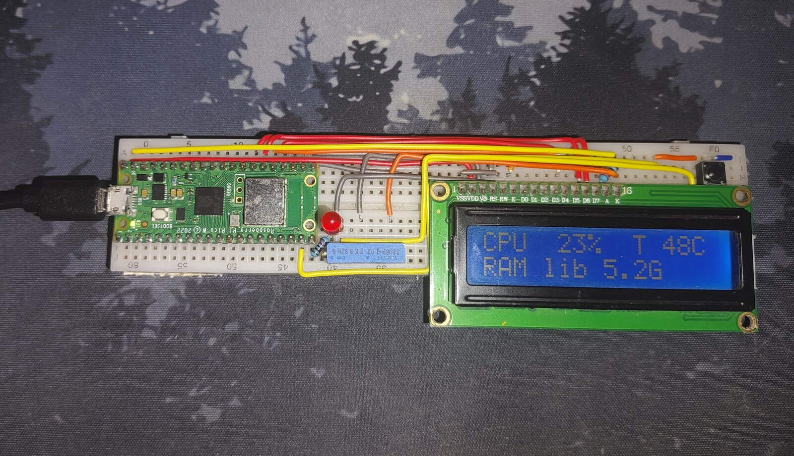

🇬🇧 English | [🇮🇹 Italiano](README.it.md)

---

# Pico Server Monitor

Shows the status of a CasaOS server on a 1602A LCD display, using a Raspberry Pi Pico W.

<p align="center">
  
</p>

## Features

- CPU usage, temperature, free RAM and used RAM percentage
- Used and free space on two disks
- Uptime and load average
- Button to switch between screens
- Warning LED: steady on above a first temperature threshold, blinking above a second, higher one

## How it works

The server runs [Glances](https://github.com/nicolargo/glances) in Docker, which exposes a REST API.
The Pico W reads the data over Wi-Fi using [MicroPython](https://micropython.org/download/RPI_PICO_W/) and writes it to the display.

> [!NOTE]
> The Pico W only supports 2.4 GHz Wi-Fi networks.

---

## Parts list

- Raspberry Pi Pico W
- 1602A LCD display (16 pins, 4-bit mode, 2 rows)
- 10 kΩ trimmer potentiometer
- Red LED
- 220 Ω resistor (for the backlight) and 220 Ω resistor (for the LED)
- Push button
- Breadboard and jumper wires

---

## Wiring

### 1602A LCD display

| LCD pin | Name | Connection |
|---|---|---|
| 1 | VSS | GND |
| 2 | VDD | 5V (VBUS) |
| 3 | V0 | trimmer wiper (middle pin) |
| 4 | RS | GP16 |
| 5 | RW | GND |
| 6 | E | GP17 |
| 11-14 | D4-D7 | GP18-GP21 |
| 15 | A | 5V through a 220 Ω resistor |
| 16 | K | GND |

The outer pins of the trimmer go to 5V and GND.

### Warning LED

| Component | Connection |
|---|---|
| Anode (long leg) | GP15 through a 220 Ω resistor |
| Cathode (short leg) | GND |

### Button

| Component | Connection |
|---|---|
| Contact 1 | GP14 |
| Contact 2 | GND |

No external resistor is needed: the code uses the Pico's internal pull-up.

---

## Installation

### 1. Server

1. Copy `server/docker-compose.yml` to your server (or import it as a custom app in CasaOS).
2. Start Glances:
```bash
   docker compose up -d
```
3. Check that the API responds:
```bash
   curl http://SERVER_IP:61208/api/4/fs
```
   Note the `mnt_point` values of your disks: you will need them for the configuration.

### 2. Pico W

1. Install the MicroPython firmware for the **Pico W** (hold BOOTSEL while plugging in the USB cable, then copy the `.uf2` file).
2. Using [Thonny](https://thonny.org), save `pico/lcd.py` and `pico/main.py` onto the Pico.
3. Copy `pico/config.example.py`, rename it `config.py` and fill it in (see below).
4. Save `config.py` onto the Pico and press **F5** to test.
5. For normal use, unplug the Pico from the computer and power it with a USB charger: `main.py` starts automatically.

> [!WARNING]
> `config.py` contains your Wi-Fi password. It is listed in `.gitignore` and must never be published.

---

## Configuration

Start from the [example configuration](pico/config.example.py) and edit these values:

| Variable | Meaning |
|---|---|
| `SSID` | Wi-Fi network name |
| `PASSWORD` | Wi-Fi password |
| `GLANCES` | Glances address, for example `http://192.168.1.50:61208` |
| `TEMP_ON` | Temperature (°C) from which the LED stays on |
| `TEMP_BLINK` | Temperature (°C) from which the LED blinks |
| `DISKS` | List of disks to show: a 3-letter label and the `mnt_point` as it appears in `/api/4/fs` |

---

## Screens

The button cycles through the screens.

1. **System:** CPU %, temperature, free RAM and used RAM %
2. **Disks:** used percentage and free space of the two disks
3. **Uptime:** uptime and load average (1, 5 and 15 minutes)

---

## Troubleshooting

- **Display is lit but blank:** adjust the contrast trimmer.
- **`ImportError: no module named 'lcd'`:** `lcd.py` was not saved onto the Pico (not on the computer), or it has a different name.
- **`Permission denied: '/dev/ttyACM0'` (Linux):** add your user to the group that owns the port (`uucp` on Arch, `dialout` on Debian/Ubuntu), then log out and back in.
- **"Glances offline" on the display:** check the IP in `config.py` and make sure the container is running.
- **Wi-Fi does not connect:** make sure the network is 2.4 GHz and that SSID and password are correct.

---

## Useful links

- [Glances](https://github.com/nicolargo/glances)
- [MicroPython for Pico W](https://micropython.org/download/RPI_PICO_W/)
- [MicroPython documentation](https://docs.micropython.org)

